# Token-Authentifizierung (JWT)

Das Backend arbeitet **stateless**: Es gibt keine Session. Jeder Request beweist mit einem Token, wer ihn schickt.
Dafür gibt es zwei Tokens:

| | Access-Token | Refresh-Token |
|---|---|---|
| **Gültig** | 15 Minuten | 1 Tag |
| **Wird gesendet** | bei **jedem** Request im Header | **nur** an `POST /auth/refresh` im Body |
| **Inhalt** | E-Mail, Vorname, Nachname | nur E-Mail |
| **Wofür** | Zugriff auf geschützte Endpunkte | neuen Access-Token holen, ohne neu einzuloggen |

Der Access-Token ist ständig unterwegs, deshalb lebt er nur kurz. Wird er gestohlen, ist er nach spätestens 15 Minuten wertlos.
Der Refresh-Token lebt länger, wird dafür aber fast nie verschickt.

---

## Ablauf



1. **Login:** Das Frontend schickt E-Mail und Passwort und bekommt **beide** Tokens zurück. Beide werden gespeichert.
2. **Normale Requests:** Jeder Request schickt **nur den Access-Token** im Header mit.
3. **Access-Token abgelaufen:** Das Backend antwortet mit `401`. Das Frontend holt sich mit dem Refresh-Token einen neuen Access-Token und wiederholt den Request.
4. **Refresh-Token abgelaufen:** `/auth/refresh` antwortet mit `401`. Das Frontend löscht beide Tokens und leitet zur Login-Seite weiter.

---

## Endpunkte

### `POST /auth/login`

Request:
```json
{ "email": "max@test.de", "password": "geheim123" }
```

Response `200`:
```json
{ "accessToken": "eyJ...", "refreshToken": "eyJ..." }
```

Bei falscher E-Mail **oder** falschem Passwort: `401 Invalid email or password`.
Beide Fälle haben bewusst dieselbe Meldung, damit niemand herausfinden kann, welche E-Mails registriert sind.

### `POST /auth/refresh`

Request:
```json
{ "refreshToken": "eyJ..." }
```

Response `200`: ein **neuer** Access-Token und **derselbe** Refresh-Token:
```json
{ "accessToken": "eyJ...(neu)", "refreshToken": "eyJ...(unverändert)" }
```

`401`, wenn der Refresh-Token abgelaufen oder ungültig ist, wenn ein **Access**-Token geschickt wurde oder wenn es den User nicht mehr gibt.

### Geschützte Endpunkte

Alle Pfade außer `/auth/**` brauchen einen gültigen Access-Token:
```
Authorization: Bearer <accessToken>
```
Ohne gültigen Token kommt `401`. Ein Refresh-Token wird hier **nicht** akzeptiert.

---

## Was steht im Token?

Ein JWT besteht aus drei Teilen, getrennt durch Punkte: `header.payload.signatur`.
Den Payload kann jeder lesen, z. B. auf [jwt.io](https://jwt.io). Er ist nur Base64-kodiert, **nicht verschlüsselt**.

Access-Token:
```json
{
  "sub": "max@test.de",
  "type": "access",
  "firstName": "Max",
  "lastName": "Muster",
  "iat": 1795206192,
  "exp": 1795207092
}
```

Refresh-Token:
```json
{
  "sub": "max@test.de",
  "type": "refresh",
  "iat": 1795206192,
  "exp": 1795292592
}
```

| Feld | Bedeutung |
|---|---|
| `sub` | Subject: die E-Mail, damit wird der User eindeutig erkannt |
| `type` | `access` oder `refresh`. Verhindert, dass ein Token-Typ als der andere benutzt wird |
| `firstName`, `lastName` | Nur im Access-Token. Das Frontend kann den Namen direkt aus dem Token lesen |
| `iat` | Issued at: Erstellungszeitpunkt (Unix-Sekunden) |
| `exp` | Expiration: Ablaufzeitpunkt (Unix-Sekunden) |

> ⚠️ Keine Passwörter oder anderen geheimen Daten in den Token schreiben, der Inhalt ist für jeden lesbar.
> Fälschen kann man ihn aber nicht: Die Signatur wird mit `JWT_SECRET` erstellt und bei jedem Request geprüft.

---

## Beteiligte Dateien

| Datei | Aufgabe |
|---|---|
| [`JwtUtil.java`](JwtUtil.java) | Tokens erstellen (`generateAccessToken`, `generateRefreshToken`) und prüfen (`isValidAccessToken`, `isValidRefreshToken`, `extractEmail`) |
| [`JwtAuthenticationFilter.java`](JwtAuthenticationFilter.java) | Läuft vor **jedem** Request. Liest den `Authorization`-Header und meldet den User an, wenn ein gültiger **Access**-Token drinsteht |
| [`../SecurityConfig.java`](../SecurityConfig.java) | Legt fest, welche Pfade offen (`/auth/**`) und welche geschützt sind, und hängt den Filter ein |
| [`../refresh/RefreshController.java`](../refresh/RefreshController.java) | `POST /auth/refresh` |
| [`../../auth/login/LoginController.java`](../../auth/login/LoginController.java) | `POST /auth/login` |

Wichtig: Der Filter **blockiert** selbst nichts. Er meldet den User nur an, wenn der Token passt.
Ob ein Pfad einen angemeldeten User braucht, entscheidet allein die `SecurityConfig`.

---

## Konfiguration

In `src/main/resources/application.yaml`:

```yaml
jwt:
  secret: ${JWT_SECRET}
  access-token-validity: 15m
  refresh-token-validity: 1d
```

- `JWT_SECRET` kommt aus der `.env` und muss **mindestens 32 Zeichen** lang sein. Erzeugen z. B. mit `openssl rand -base64 48`.
- Die Laufzeiten lassen sich hier ändern, z. B. `30m`, `2h`, `7d`.
- Ändert sich das Secret, werden **alle** bestehenden Tokens ungültig und alle User müssen sich neu einloggen.

---

## Frontend: automatisch refreshen

Das Backend kann den Refresh nicht selbst auslösen. Es antwortet nur mit `401`.
Das Frontend fängt das **einmal zentral** in einem HTTP-Interceptor ab, nicht in jeder Komponente:

1. Access-Token an jeden Request hängen.
2. Kommt `401` (und der Request war **nicht** an `/auth/...`), `POST /auth/refresh` aufrufen.
3. Den neuen Access-Token speichern und den ursprünglichen Request wiederholen.
4. Schlägt auch der Refresh mit `401` fehl: beide Tokens löschen und zur Login-Seite.

Die Komponenten merken davon nichts.

**Logout:** Die Tokens werden im Backend nicht gespeichert. Ein Logout bedeutet also, dass das Frontend beide Tokens löscht.

---

## Testen mit Postman

1. `POST http://localhost:8080/auth/login` → Body → raw → JSON mit E-Mail und Passwort. Beide Tokens aus der Antwort kopieren.
2. `GET http://localhost:8080/user/me` → Tab **Authorization** → Type **Bearer Token** → Access-Token einfügen. Antwort: die E-Mail.
3. `POST http://localhost:8080/auth/refresh` → Body `{ "refreshToken": "..." }`. Antwort: ein neuer Access-Token.
4. Gegenproben, die alle `401` liefern müssen:
   - `/user/me` ohne Token
   - `/user/me` mit dem Refresh-Token
   - `/auth/refresh` mit dem Access-Token
